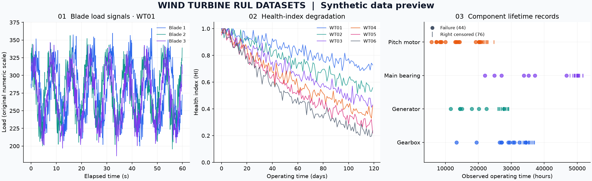

<div align="center">

# Wind Turbine RUL Datasets
### 风机剩余寿命预测模拟数据集

**雨流疲劳 · 健康指数退化 · Weibull 生存分析**


面向寿命分析软件开发、算法学习与功能演示的三组模拟数据。

[数据文件](datasets/) · [字段字典](docs/DATA_DICTIONARY.md) · [数据说明](docs/DATA_CARD.md) · [质量检查](docs/QUALITY_REPORT.md)

</div>



## 数据一览

| 数据集 | 规模 | 时间 / 寿命轴 | 推荐用途 | 下载 |
|---|---|---|---|---|
| **叶片载荷** | 3,600 行 · 6 台模拟机组 | 0.1 秒采样；每台 600 点 | 雨流计数、载荷谱与疲劳计算流程测试 | [CSV](datasets/rul_blade_load_fatigue.csv) · [Parquet](datasets/rul_blade_load_fatigue.parquet) |
| **健康指数退化** | 720 行 · 6 台模拟机组 | 第 0–119 天；每台 120 点 | HI 趋势拟合与阈值外推流程测试 | [CSV](datasets/rul_bearing_degradation.csv) · [Parquet](datasets/rul_bearing_degradation.parquet) |
| **部件寿命记录** | 每份 120 行；CSV为单部件版，Parquet为四部件版 | 累计运行小时；各44失效 / 76右删失 | Weibull、生存曲线与删失数据处理测试 | [CSV 单部件](datasets/rul_component_failures.csv) · [Parquet 四部件](datasets/rul_component_failures.parquet) |

**4,440 行为每种格式分别计数的合计。**载荷、退化两组的CSV与Parquet数值一致；寿命记录的两个文件是不同模拟版本，不能直接互换或合并。图中寿命预览采用四部件Parquet版。

## 快速开始

```bash
git clone https://github.com/cheercao/wind-turbine-rul-datasets.git
cd wind-turbine-rul-datasets
python -m pip install -r requirements.txt
python scripts/validate.py
```

```python
import pandas as pd

loads = pd.read_csv("datasets/rul_blade_load_fatigue.csv", parse_dates=["timestamp"])
hi = pd.read_csv("datasets/rul_bearing_degradation.csv", parse_dates=["date"])
life = pd.read_parquet("datasets/rul_component_failures.parquet")

failed = life[life["failed_event"] == 1]       # 44 条失效记录
censored = life[life["failed_event"] == 0]    # 76 条观察结束时未失效的记录
```

## 如何对应三类算法

**雨流疲劳**：使用 `blade_edge_1/2/3` 载荷时序。载荷不能未经标定直接当作 MPa 应力；材料/结构 S-N 参数需要匹配输入单位。数据仅覆盖短时模拟载荷，不提供真实服役历史或真实剩余年限标签。

**HI 退化**：使用 `operating_days` 与 `health_index_hi`，按机组分别拟合。HI 阈值需由使用者给出；拟合曲线不一定在未来穿过阈值。导入原软件时将时间字段 `timestamp` 映射到文件中的 `date`。

**Weibull 生存分析**：使用 `component_type`、`operating_hours`、`failed_event`。`1` 表示失效，`0` 表示右删失。未失效样本的运行时长不是故障时间，不能全部当作失效。不同部件应分别分析。**推荐四类部件对比时使用Parquet版；CSV版120行均为Gearbox_Bearing。两版使用了相同形式的记录ID，不能按ID拼接。**

## 数据来源与适用范围

这六个文件直接整理自本地软件项目中已有的模拟样例，**原始数值未修改，也未为匹配算法重新生成**。它们不是风场实测数据、公开故障日志或 NASA 数据。

适合输入兼容、数值方法学习、图表展示和开发回归。数据不构成真实设备寿命基准，不包含足以验证现场 RUL 准确性的独立真实标签。具体生成公式、随机种子和物理标定信息未随原文件提供；本仓库不补写无法核实的来源信息。

本仓库只提供数据和加载/校验工具，不包含原软件的寿命预测实现，也不为任何实现的统计正确性作保证。

## 文件结构

```text
datasets/                 # 六个原始数据文件（CSV / Parquet）
assets/dataset-overview.png
docs/DATA_CARD.md         # 来源、用途与局限
docs/DATA_DICTIONARY.md   # 字段、单位和编码
docs/QUALITY_REPORT.md    # 数据完整性检查结果
scripts/validate.py       # SHA-256、字段及双格式一致性校验
manifest.json             # 原始文件大小、行数、字段、SHA-256
requirements.txt
CHANGELOG.md
```

下载全部内容可使用仓库的 **Code → Download ZIP**。许可状态见 [数据说明](docs/DATA_CARD.md#许可状态)。
